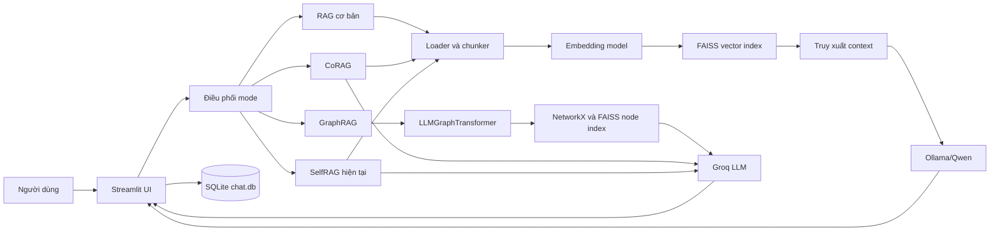

# BẢN DỰ THẢO BÁO CÁO: TỪ TRANG TIÊU ĐỀ ĐẾN HẾT CHƯƠNG 1

> Bản nháp này chọn **Ollama / Local LLM** làm công nghệ khảo sát chính theo tài liệu hướng dẫn. Trước khi nộp, cần xác nhận đúng công nghệ nhóm đã đăng ký ở Phần A. Những nội dung trong ngoặc vuông cần điền; các số liệu chưa đo được ghi rõ là chưa có, không trình bày như kết quả.

## TRANG TIÊU ĐỀ

**Tên đề tài đề xuất nếu nhóm đã đăng ký Ollama:**

**TÌM HIỂU VÀ ỨNG DỤNG OLLAMA TRONG HỆ THỐNG HỎI ĐÁP TÀI LIỆU PDF SỬ DỤNG RAG, LANGCHAIN VÀ FAISS**

Trường: [Tên trường]  
Khoa/Bộ môn: [Tên khoa/bộ môn]  
Học phần: Các Công nghệ Lập trình Hiện đại  
Giảng viên hướng dẫn: [Họ tên giảng viên]  
Nhóm: [Tên/số nhóm]  
Sinh viên thực hiện: [Họ tên, mã số sinh viên]  
Lớp: [Tên lớp]  
Thời gian: [Học kỳ, năm học]

> Nếu tên đề tài đã được giảng viên duyệt là “Xây dựng hệ thống hỏi đáp tài liệu PDF sử dụng kiến trúc RAG với thư viện LangChain và cơ sở dữ liệu vector FAISS”, giữ nguyên tên đã duyệt. Không tự đổi công nghệ đăng ký trong báo cáo nếu chưa xác nhận với giảng viên.

## LỜI MỞ ĐẦU

### 1. Lý do chọn đề tài

Trong học tập và công việc, người dùng thường cần tìm nhanh thông tin trong các tài liệu PDF có nhiều trang. Đọc thủ công tốn thời gian, trong khi tìm kiếm theo từ khóa có thể bỏ sót nội dung được diễn đạt bằng cách khác. Mô hình ngôn ngữ lớn có thể trả lời bằng ngôn ngữ tự nhiên, nhưng nếu không được cung cấp tài liệu liên quan thì câu trả lời có thể không căn cứ vào nguồn mà người dùng mong muốn.

Đề tài xây dựng ứng dụng hỏi đáp tài liệu theo hướng Retrieval-Augmented Generation (RAG). Hệ thống trích xuất nội dung tài liệu, chia văn bản thành các đoạn nhỏ, chuyển các đoạn thành vector, truy xuất những đoạn liên quan đến câu hỏi, rồi đưa chúng vào ngữ cảnh cho mô hình ngôn ngữ sinh câu trả lời. Cách làm này nhằm gắn câu trả lời với nội dung tài liệu thay vì chỉ dựa vào tri thức có sẵn của mô hình.

Trong phiên bản hiện tại, FAISS đảm nhiệm tìm kiếm vector; LangChain kết nối các thành phần xử lý tài liệu, truy xuất và gọi mô hình; Ollama cung cấp runtime cục bộ để chạy Qwen. Nhóm chọn khảo sát Ollama vì muốn tìm hiểu cách tích hợp mô hình ngôn ngữ chạy trên máy cá nhân vào ứng dụng, giảm phụ thuộc vào API thương mại trong luồng RAG chính. Model đã được chạy thử thành công qua Ollama. Tuy nhiên, model chạy được chưa đồng nghĩa với chất lượng trả lời tốt hay mức sử dụng tài nguyên phù hợp; các nội dung đó cần được đo riêng.

Đề tài phù hợp với định hướng tìm hiểu AI tạo sinh và xây dựng ứng dụng tích hợp mô hình ngôn ngữ. Nhóm có cơ hội tìm hiểu lựa chọn model/runtime, xử lý ngữ cảnh, thiết kế pipeline RAG và phương pháp đánh giá. Việc chọn đề tài cũng giúp nhóm nhận diện giới hạn của mô hình local, gồm yêu cầu phần cứng, độ trễ và khả năng trả lời đúng theo tài liệu.

### 2. Mục tiêu báo cáo

#### 2.1. Mục tiêu kiến thức

- Trình bày đúng vai trò của Ollama: runtime/nền tảng phục vụ tải, quản lý và chạy mô hình ngôn ngữ; phân biệt Ollama với model Qwen, framework LangChain và thư viện vector FAISS.
- Giải thích cách ứng dụng gửi yêu cầu từ LangChain đến model Ollama đang chạy cục bộ.
- Mô tả pipeline RAG gồm đọc tài liệu, chia đoạn, embedding, tìm kiếm vector, tạo prompt và sinh câu trả lời.
- Tìm hiểu ảnh hưởng của kích thước model và mức lượng tử hóa đến dung lượng, yêu cầu bộ nhớ và chất lượng đầu ra.
- Xây dựng quy trình kiểm tra các yêu cầu cốt lõi của hướng Local LLM/Ollama: lựa chọn model/runtime, theo dõi tài nguyên, kiểm tra context window, đo độ trễ, đánh giá chất lượng và đối chiếu với phương án thay thế.

Các mục đo tài nguyên, độ trễ, chất lượng và so sánh là **mục tiêu cần thực hiện**, chưa phải kết quả đã đạt. Nhóm sẽ cập nhật bằng số đo và minh chứng thu được.

#### 2.2. Mục tiêu kỹ năng

- Cài đặt, kiểm tra runtime LLM cục bộ trên Windows và chạy model qua CLI/API.
- Tích hợp model Ollama với ứng dụng Python thông qua LangChain.
- Xây dựng pipeline RAG kết hợp embedding và FAISS.
- Thiết kế bộ câu hỏi thử nghiệm có đáp án hoặc tiêu chí chấm rõ ràng; ghi nhận đầu ra, thời gian xử lý và lỗi.
- Đọc tài liệu chính thức, phân biệt kết quả đo với nhận xét định tính và trình bày giới hạn của giải pháp.
- Phối hợp nhóm, quản lý mã nguồn, phân công công việc và ghi lại tiến độ hằng tuần.

### 3. Phạm vi nghiên cứu

Đề tài tập trung vào hệ thống hỏi đáp tài liệu PDF theo kiến trúc RAG. Phiên bản hiện tại có các thành phần và cấu hình sau:

- Giao diện Streamlit cho phép tải tài liệu, nhập câu hỏi, chọn chế độ và xem câu trả lời.
- Bộ đọc tài liệu trích xuất văn bản theo trang. Giao diện hiện nhận cả PDF và DOCX, nhưng phạm vi đánh giá chính trong báo cáo này là PDF.
- Văn bản được chia bằng `RecursiveCharacterTextSplitter`; mặc định `chunk_size = 500`, `chunk_overlap = 50`, có thể điều chỉnh trên giao diện.
- Embedding sử dụng `sentence-transformers/paraphrase-multilingual-mpnet-base-v2` thông qua `HuggingFaceEmbeddings`. Một truy vấn thử nghiệm đã tạo vector 768 chiều.
- FAISS lưu và tìm vector. Index của mỗi tài liệu được lưu cục bộ trong `storage/vector_indices` theo mã băm nội dung để có thể tái sử dụng.
- Chế độ RAG tìm ba đoạn gần câu hỏi nhất (`k = 3`), ghép chúng vào prompt, rồi gọi `qwen2.5-coder:7b` thông qua LangChain `OllamaLLM`.
- Tham số sinh văn bản khởi tạo trên giao diện là temperature 0.7, top-p 0.9 và repeat penalty 1.1.

Ứng dụng còn có GraphRAG, CoRAG và SelfRAG. Các luồng đó sử dụng Groq và cần biến môi trường `GROQ_API_KEY`; không thuộc phạm vi đánh giá Ollama local trong báo cáo này. GraphRAG dùng NetworkX để biểu diễn đồ thị tri thức; không nên diễn đạt điều đó thành đã dùng LangGraph.

Hiện nhóm chưa có số đo chính thức về RAM/VRAM, tốc độ sinh token, độ trễ trên bộ câu hỏi cố định, chất lượng so sánh với model API hay benchmark trực tiếp Ollama với llama.cpp. Báo cáo sẽ không kết luận định lượng các nội dung này cho đến khi có thí nghiệm và bằng chứng.

### 4. Kế hoạch và tiến độ thực hiện — 12 tuần

Bảng sau là **kế hoạch đề xuất**, cần điều chỉnh theo tiến độ thực tế của nhóm. Điền người phụ trách và trạng thái dựa trên nhật ký/commit thực tế; không dùng kế hoạch này thay cho nhật ký đã diễn ra.

| Tuần | Công việc dự kiến | Người phụ trách | Trạng thái/kết quả cần lưu |
|---|---|---|---|
| 1 | Chốt track/công nghệ đăng ký, tên đề tài, mục tiêu và phạm vi | [Điền] | Biên bản chốt đề tài, yêu cầu Phần A |
| 2 | Đọc tài liệu Ollama, LangChain, FAISS; xác định pipeline | [Điền] | Tóm tắt tài liệu, sơ đồ kiến trúc |
| 3 | Khảo sát model, lượng tử hóa và yêu cầu phần cứng | [Điền] | Thông tin model, cấu hình máy, nguồn tham khảo |
| 4 | Cài đặt Ollama và chạy model cục bộ | [Điền] | Lệnh chạy, log, thời gian và lỗi |
| 5 | Hoàn thiện đọc và chia đoạn tài liệu | [Điền] | Kết quả thử PDF, tham số chunk |
| 6 | Tích hợp embedding và FAISS; kiểm tra top-k | [Điền] | Kết quả truy xuất trên tài liệu mẫu |
| 7 | Tích hợp LangChain với Ollama trong RAG | [Điền] | Ảnh giao diện, câu hỏi và phản hồi mẫu |
| 8 | Thiết kế bộ câu hỏi và tiêu chí đánh giá | [Điền] | Bộ câu hỏi, đáp án/rubric |
| 9 | Đo độ trễ và RAM/VRAM trên cùng cấu hình | [Điền] | Bảng đo, công cụ và điều kiện thử |
| 10 | Thử context window và so sánh phương án thay thế | [Điền] | Kết quả hoặc lý do chưa thể thử |
| 11 | Hoàn thiện hands-on lab, viết báo cáo và chấm chéo | [Điền] | Bản nháp, nhận xét chấm chéo |
| 12 | Sửa báo cáo, hoàn thiện minh chứng và chuẩn bị trình bày | [Điền] | Bản nộp, slide, demo tái hiện được |

### 5. Cấu trúc báo cáo

Báo cáo gồm bốn phần chính. **Phần 1 – Tổng quan và phân tích công nghệ** giới thiệu Ollama, bối cảnh, kiến trúc, nguyên lý, vị trí trong hệ thống và so sánh với các lựa chọn thay thế. **Phần 2 – Kiến thức bản chất và thực hành** trình bày môi trường, cách cấu hình, tích hợp, kiểm thử và hands-on lab. **Phần 3 – Xây dựng đồ án tổng hợp** mô tả yêu cầu, thiết kế, triển khai SmartDoc AI, luồng dữ liệu, giao diện và minh chứng. **Phần 4 – Tổng kết và bài học** đối chiếu mục tiêu với kết quả, phân tích lỗi, giới hạn, hướng phát triển và khai báo việc sử dụng công cụ AI. Báo cáo kết thúc bằng tài liệu tham khảo và phụ lục gồm nhật ký tuần, minh chứng làm việc nhóm và tài liệu thực hành theo yêu cầu học phần.

## PHẦN 1: TỔNG QUAN VÀ PHÂN TÍCH CÔNG NGHỆ

# CHƯƠNG 1: GIỚI THIỆU VỀ OLLAMA

## 1.1. Bối cảnh và lịch sử

### 1.1.1. Bối cảnh ra đời

Mô hình ngôn ngữ lớn có thể xử lý và sinh văn bản, nhưng việc sử dụng mô hình thường đòi hỏi tải trọng số, cài thư viện tương thích, cấu hình bộ tăng tốc phần cứng và tự xây dựng cách gửi yêu cầu. Những bước này làm tăng độ phức tạp khi người phát triển muốn thử nhiều model hoặc tích hợp model vào ứng dụng cá nhân.

Ollama được xây dựng như một runtime/công cụ giúp tải, quản lý và chạy các mô hình ngôn ngữ theo quy trình thống nhất hơn. Người dùng có thể lấy model từ thư viện, chạy trực tiếp bằng CLI hoặc gửi yêu cầu qua API cục bộ. Nhờ lớp runtime/API, ứng dụng có thể tập trung vào nghiệp vụ mà không phải tự triển khai toàn bộ việc nạp model và thực thi suy luận.

Theo các tài liệu và bài viết công khai của dự án, Ollama đã được giới thiệu rộng rãi trong năm 2023, cùng thời điểm các mô hình trọng số mở như Llama 2 được cộng đồng quan tâm và nhu cầu chạy LLM trên máy cá nhân tăng lên. Dự án tiếp tục mở rộng hỗ trợ model, nền tảng và phần cứng. Khi hoàn thiện báo cáo, nhóm cần ghi ngày truy cập tài liệu chính thức vì phiên bản và tính năng có thể thay đổi.

### 1.1.2. Vấn đề Ollama hướng đến giải quyết

Ollama giúp đơn giản hóa một số công việc khi thử nghiệm và tích hợp LLM:

- Quản lý model/tag bằng các lệnh tải, liệt kê và chạy.
- Thử model trực tiếp qua CLI trước khi nối vào ứng dụng.
- Cung cấp server/API cục bộ để chương trình gửi prompt và nhận kết quả.
- Chuẩn hóa một phần quy trình runtime, thay vì để mỗi ứng dụng tự quản lý cách nạp model.
- Khai thác CPU hoặc backend tăng tốc phần cứng mà Ollama hỗ trợ trên từng nền tảng.

Ollama không làm cho mọi model chạy nhanh trên mọi máy. Tốc độ và khả năng chạy phụ thuộc vào kích thước model, mức lượng tử hóa, context, bộ nhớ khả dụng, CPU/GPU, backend và cấu hình. “Chạy local” không có nghĩa là không tốn tài nguyên hoặc luôn phản hồi nhanh.

### 1.1.3. Loại hình và vị trí trong hệ sinh thái

Trong đề tài này, Ollama được phân loại là **runtime/nền tảng phục vụ quản lý và suy luận mô hình ngôn ngữ cục bộ**. Ollama không phải mô hình ngôn ngữ; model đang dùng là `qwen2.5-coder:7b`. Ollama cũng không phải framework RAG, vector database hay thành phần thay thế LangChain/FAISS.

| Thành phần | Loại hình | Vai trò trong SmartDoc AI |
|---|---|---|
| Ollama | Runtime/server chạy model | Cung cấp model local và API sinh văn bản |
| Qwen2.5-Coder 7B | Mô hình ngôn ngữ | Nhận prompt có ngữ cảnh và tạo câu trả lời |
| LangChain | Framework/thư viện ứng dụng LLM | Kết nối Ollama, tài liệu, FAISS và các bước RAG |
| Hugging Face Embeddings/Sentence Transformers | Thư viện và model embedding | Chuyển câu hỏi, đoạn văn thành vector |
| FAISS | Thư viện tìm kiếm vector | Lưu và truy xuất vector gần với câu hỏi |
| Streamlit | Framework giao diện Python | Hiển thị tải tài liệu, nhập câu hỏi và kết quả |
| RAG | Kiến trúc/pattern ứng dụng | Kết hợp truy xuất thông tin với sinh văn bản |

## 1.2. Kiến trúc và nguyên lý hoạt động

### 1.2.1. Các thành phần chính của Ollama

Ở mức tổng quan, ứng dụng dùng Ollama có các thành phần sau:

1. **Model:** trọng số và cấu hình của mô hình ngôn ngữ. SmartDoc AI cấu hình `qwen2.5-coder:7b`.
2. **Ollama CLI:** tải, liệt kê và chạy model; `ollama list` hiển thị model đã có.
3. **Ollama server/API:** tiến trình nền nhận yêu cầu từ ứng dụng. API local mặc định thường ở `http://localhost:11434`.
4. **Backend thực thi:** runtime nạp model và thực hiện suy luận trên CPU hoặc backend tăng tốc phù hợp với nền tảng.
5. **Ứng dụng khách:** chương trình gọi API. Trong đồ án, LangChain cung cấp `OllamaLLM` để gửi prompt và nhận phản hồi.

Ollama tạo ranh giới giữa model runtime và ứng dụng. SmartDoc AI xử lý giao diện, tài liệu và truy xuất ngữ cảnh; Ollama thực hiện suy luận cho bước sinh câu trả lời. Nếu server không chạy hoặc tên model cấu hình sai, lời gọi sinh văn bản sẽ thất bại.

### 1.2.2. Lượng tử hóa model

Lượng tử hóa là kỹ thuật biểu diễn trọng số bằng định dạng số có độ chính xác thấp hơn để giảm dung lượng model và nhu cầu bộ nhớ. Metadata của model đã cài trên máy hiển thị `qwen2.5-coder:7b`, khoảng 7,6 tỷ tham số, kích thước tệp xấp xỉ 4,7 GB và mức lượng tử hóa `Q4_K_M`.

`Q4_K_M` là một biến thể lượng tử hóa 4-bit thuộc họ K-quant. Không nên suy ra RAM khi chạy chỉ bằng kích thước tệp 4,7 GB: runtime còn cần bộ nhớ cho context, cache, buffer và tiến trình ứng dụng. Lượng tử hóa giúp giảm nhu cầu bộ nhớ nhưng có thể ảnh hưởng chất lượng tùy model/tác vụ. Nhóm cần đo thực tế thay vì kết luận mức đánh đổi chỉ từ tag.

### 1.2.3. Luồng xử lý RAG của SmartDoc AI

Luồng RAG chính gồm các bước:

1. Người dùng tải tài liệu qua giao diện Streamlit. Báo cáo tập trung vào PDF; phiên bản hiện tại cũng nhận DOCX.
2. Bộ đọc trích xuất văn bản theo trang và thông tin nguồn.
3. `RecursiveCharacterTextSplitter` chia văn bản theo chunk size/overlap; mặc định 500 và 50 ký tự.
4. `sentence-transformers/paraphrase-multilingual-mpnet-base-v2` chuyển các đoạn thành vector embedding.
5. FAISS lưu index và tìm ba đoạn gần vector câu hỏi nhất (`k = 3`). Index được lưu cục bộ theo mã băm nội dung tài liệu.
6. Các đoạn truy xuất được ghép với câu hỏi thành prompt.
7. LangChain `OllamaLLM` gửi prompt đến `qwen2.5-coder:7b` qua Ollama local. Tham số giao diện khởi tạo: temperature 0.7, top-p 0.9, repeat penalty 1.1.
8. Streamlit hiển thị câu trả lời và tiến độ xử lý.

```text
PDF/DOCX
  -> Trích xuất văn bản theo trang
  -> Chia đoạn (chunk_size=500, overlap=50 mặc định)
  -> Sentence Transformers tạo embedding
  -> FAISS tìm top-3 đoạn liên quan
  -> LangChain ghép context vào prompt
  -> Ollama chạy qwen2.5-coder:7b
  -> Câu trả lời hiển thị trên Streamlit
```

Ollama chỉ tham gia bước suy luận sinh câu trả lời trong luồng này. Embedding do Hugging Face Sentence Transformers tạo; FAISS truy xuất vector. LangChain kết nối các bước RAG. Repo chưa dùng LangGraph để định nghĩa workflow bằng State/Nodes/Edges.

### 1.2.4. Cấu hình và trạng thái kiểm chứng

| Hạng mục | Trạng thái hiện biết | Việc cần làm trước khi chốt báo cáo |
|---|---|---|
| Runtime | Ollama chạy trên Windows; API local đã phản hồi | Ghi phiên bản bằng `ollama --version` |
| Model | `qwen2.5-coder:7b` có trên máy và đã trả lời thử | Lưu ảnh/log `ollama list` và kết quả chạy |
| Lượng tử hóa | Metadata hiển thị `Q4_K_M` | Lưu `ollama show qwen2.5-coder:7b` làm minh chứng |
| Embedding | Model đa ngôn ngữ; một vector truy vấn có 768 chiều | Ghi model/phiên bản chính xác |
| Retrieval | FAISS, top-k bằng 3 | Kiểm tra các đoạn lấy về có liên quan trên bộ tài liệu mẫu |
| Cửa sổ ngữ cảnh | Metadata model ghi context length 32.768 token; app không truyền `num_ctx` riêng | Phân biệt giới hạn model với cấu hình thực tế và kiểm thử |
| RAM/VRAM | Chưa có số đo chính thức | Đo bằng công cụ phù hợp và ghi điều kiện thử |
| Độ trễ/tốc độ | Chưa có benchmark có kiểm soát | Chạy lặp lại trên cùng câu hỏi, tài liệu, model và cấu hình |
| Chất lượng | Chưa có bộ câu hỏi/rubric đánh giá chính thức | Tạo bộ câu hỏi, đáp án kỳ vọng và quy tắc chấm |

Do model mang hậu tố `coder`, nhóm cần kiểm tra mức phù hợp của nó với hỏi đáp tổng quát trên PDF tiếng Việt. Một lần chạy thành công chỉ chứng minh đường kết nối hoạt động, chưa chứng minh chất lượng tổng thể.

## 1.3. So sánh và đánh giá (tư duy phản biện)

### 1.3.1. Đối chiếu sơ bộ với phương án thay thế

Nhóm đã chạy thử suy luận Ollama và xác nhận model phản hồi qua tích hợp LangChain. Chưa có benchmark đối chứng trên cùng máy, prompt và bộ câu hỏi với llama.cpp hoặc API thương mại. Bảng dưới đây vì vậy là so sánh sơ bộ về cách triển khai, không phải kết luận hiệu năng thực nghiệm.

| Tiêu chí | Ollama (đang tích hợp) | llama.cpp (chưa benchmark) | Model qua API thương mại (chưa benchmark) |
|---|---|---|---|
| Vai trò | Runtime/server quản lý và chạy model local, có CLI và API | Runtime suy luận tập trung vào model/định dạng tương thích và cấu hình thực thi | Dịch vụ suy luận do nhà cung cấp vận hành qua mạng |
| Điều kiện chạy | Ollama server và model phải có trên máy | Cần cài/cấu hình binary, model và tham số | Cần mạng, credentials và tuân theo quota/chính sách |
| Tích hợp trong repo | `OllamaLLM` đang dùng ở RAG và đã gọi model thành công | Chưa tích hợp | Nhánh Groq tồn tại nhưng cần `GROQ_API_KEY`; chưa có đối chứng đầu-cuối |
| Dữ liệu | Prompt sinh câu trả lời gửi đến runtime local trong cấu hình hiện tại; vẫn cần xem log và chính sách phần mềm | Có thể chạy local tùy cấu hình | Dữ liệu được gửi tới nhà cung cấp; cần xem điều khoản và chính sách dữ liệu |
| Hiệu năng/chất lượng | Chưa đo latency, token/s, RAM/VRAM hoặc rubric chất lượng | Chưa đo cùng phần cứng/model | Chưa đo cùng câu hỏi, prompt và rubric |

Để đáp ứng yêu cầu so sánh dựa trên trải nghiệm nhóm, cần cố định tài liệu, câu hỏi, prompt và tiêu chí đánh giá; chạy lặp lại từng phương án; ghi thời gian, đầu ra, lỗi và tài nguyên. Nếu không thể chạy llama.cpp hoặc API trong điều kiện hiện có, cần nêu rõ giới hạn thay vì tự tạo số liệu.

### 1.3.2. Ưu điểm và hạn chế của Ollama trong đề tài

**Ưu điểm:**

- Cho phép chạy model trên máy cá nhân sau khi tải, phù hợp thử nghiệm RAG không bắt buộc gọi API thương mại ở bước sinh câu trả lời.
- CLI giúp kiểm tra model độc lập với giao diện, hỗ trợ phân biệt lỗi runtime với lỗi pipeline.
- API local có thể tích hợp với LangChain thông qua `OllamaLLM`.
- Có thể thử nhiều model/tag nếu tài nguyên phần cứng cho phép.
- Model `qwen2.5-coder:7b` đã được xác nhận có thể trả lời qua Ollama trên máy hiện tại.

**Hạn chế:**

- Tốc độ và chất lượng phụ thuộc model, lượng tử hóa, phần cứng, context và cấu hình runtime.
- Model local cần dung lượng lưu trữ và bộ nhớ khi nạp; model 7B có thể chậm hoặc thiếu bộ nhớ trên máy cấu hình thấp.
- Nhóm phải cài đặt, duy trì runtime/model và xử lý lỗi trên máy triển khai.
- Khả năng của Qwen2.5-Coder đối với hỏi đáp tổng quát tiếng Việt chưa được đánh giá bằng bộ câu hỏi.
- Ứng dụng chưa tự ghi số liệu latency/RAM/VRAM, chưa có benchmark so sánh với runtime hoặc API khác.

### 1.3.3. Những trường hợp không nên chọn Ollama

1. **Máy đích thiếu tài nguyên hoặc yêu cầu phản hồi nhanh nhưng chưa được benchmark:** model lớn/context dài có thể gây chậm hoặc thiếu bộ nhớ. Cần thử đúng phần cứng triển khai; nếu không đáp ứng thì xem xét model nhỏ hơn, nâng cấp phần cứng hoặc dịch vụ suy luận được quản lý.
2. **Cần chất lượng model cao hoặc nhiều người dùng đồng thời nhưng nhóm không thể vận hành model:** local không tự bảo đảm chất lượng, khả năng mở rộng hay tính sẵn sàng. Nếu model không đạt rubric hoặc nhóm không có năng lực quản trị tài nguyên, nên so sánh với dịch vụ API/managed inference, đồng thời xem xét chi phí, bảo mật và chính sách dữ liệu.
3. **Môi trường khóa cài đặt hoặc cần quản trị tập trung nghiêm ngặt:** phân phối model nhiều GB và runtime đến từng máy có thể không phù hợp nếu thiết bị đầu cuối bị khóa hoặc chưa có phương án giám sát tập trung.

### 1.3.4. Nhận xét cho phạm vi đồ án

Ollama phù hợp để khảo sát suy luận LLM cục bộ và đã được tích hợp vào chế độ RAG của SmartDoc AI. Minh chứng hiện có xác nhận model được tải và có thể sinh phản hồi thử. Chưa đủ dữ liệu để kết luận lựa chọn này nhanh nhất, tốt nhất hoặc phù hợp nhất với cấu hình phần cứng của nhóm. Kết luận cuối cùng cần dựa trên benchmark có thể tái hiện và bộ câu hỏi được mô tả trong các chương thực nghiệm.

# CHƯƠNG 2: VỊ THẾ CÔNG NGHỆ VÀ PHẠM VI ỨNG DỤNG

## 2.1. Ollama trong hệ sinh thái ứng dụng mô hình ngôn ngữ

Ollama là runtime hỗ trợ quản lý và chạy mô hình ngôn ngữ trên máy tính cá nhân. Trong SmartDoc AI, Ollama đảm nhiệm bước gọi mô hình Qwen để tạo câu trả lời cho chế độ RAG cơ bản; nó không thay thế các thành phần xử lý tài liệu, tạo embedding hay tìm kiếm vector (xem `rag/rag.py`, `rag/embeddings.py`).

Các thành phần trong hệ thống có vai trò khác nhau:

| Thành phần | Vai trò | Nơi dùng trong đồ án |
|---|---|---|
| Ollama | Runtime phục vụ model ngôn ngữ | Kết nối model trong `rag/rag.py` |
| Qwen2.5-Coder 7B | Model tạo văn bản từ prompt | Tên model `qwen2.5-coder:7b` được cấu hình trong `rag/rag.py` |
| LangChain | Bộ thư viện kết nối các thành phần LLM/RAG | Adapter Ollama, FAISS, embedding và text splitter trong `rag/` |
| Sentence Transformers | Model/thư viện tạo vector biểu diễn văn bản | `HuggingFaceEmbeddings` trong `rag/embeddings.py` |
| FAISS | Thư viện lập chỉ mục và truy xuất vector | Lưu index tài liệu và tìm đoạn liên quan trong `rag/rag.py` |
| Streamlit | Framework giao diện viết bằng Python | Ứng dụng trong `app.py` và `ui/` |

Vì vậy, khi trình bày cần phân biệt “model chạy bằng Ollama” với “ứng dụng RAG”: Ollama chỉ là một phần của pipeline, còn RAG là cách kết hợp truy xuất tài liệu với sinh văn bản.

## 2.2. Trường hợp sử dụng phù hợp

Ollama có thể phù hợp khi cần thử nghiệm model cục bộ, muốn kiểm soát việc chạy model trên máy riêng hoặc cần tích hợp runtime local với ứng dụng Python. Trong phạm vi đồ án, mục tiêu là chạy Qwen qua `OllamaLLM` sau khi đã truy xuất ngữ cảnh từ tài liệu (xem `rag/rag.py`).

Tuy nhiên, “chạy cục bộ” không đồng nghĩa với miễn phí tài nguyên hay luôn đáp ứng tải sử dụng. Máy cần đủ dung lượng lưu model và bộ nhớ khi chạy; tốc độ còn phụ thuộc phần cứng, model, kích thước context và cấu hình. Repository chưa có số đo độ trễ, token/giây, RAM/VRAM hoặc thử tải nhiều người dùng. Các mức hiệu năng này **Cần xác nhận bằng thực nghiệm**.

## 2.3. So sánh hướng triển khai trong bối cảnh đồ án

Bảng sau so sánh điều kiện triển khai, không phải kết quả benchmark:

| Tiêu chí | Ollama local | Runtime local khác | Dịch vụ model qua API |
|---|---|---|---|
| Nơi thực thi model | Máy chạy Ollama | Máy chạy runtime tương ứng | Hạ tầng của nhà cung cấp |
| Điều kiện chính | Cài Ollama, tải model, đáp ứng tài nguyên | Cài và cấu hình runtime/model | Mạng, khóa truy cập và tuân thủ chính sách API |
| Trạng thái trong đồ án | Được gọi qua `OllamaLLM` trong RAG | Chưa thấy được tích hợp | Các mode GraphRAG, CoRAG và SelfRAG gọi Groq |
| Hiệu năng và chi phí | Chưa có số đo so sánh | Chưa đo | Chưa đo cùng điều kiện |
| Hạn chế cần cân nhắc | Tài nguyên và bảo trì model trên máy chạy | Phụ thuộc cách cấu hình cụ thể | Dữ liệu gửi tới dịch vụ ngoài; chịu quota/chính sách nhà cung cấp |

Không thể kết luận một phương án nhanh hơn, rẻ hơn hoặc an toàn hơn chỉ từ cách triển khai. Muốn so sánh cần cố định tài liệu, câu hỏi, prompt, model, phần cứng và tiêu chí đánh giá, đồng thời ghi nhận kết quả thực tế. Hiện code thể hiện cả Ollama và Groq ở các chế độ khác nhau, nhưng chưa có quy trình benchmark đối chứng (xem `rag/rag.py`, `rag/groq_model.py`, `rag/graph_rag/graphrag.py`, `rag/corag/corag.py`, `rag/selfrag/selfrag.py`).

## 2.4. Phạm vi ứng dụng SmartDoc AI

Đồ án tập trung vào ứng dụng hỏi đáp trên tài liệu do người dùng tải lên. Giao diện nhận PDF và DOCX, trong khi tài liệu đề cương tập trung vào PDF. Bộ đọc PDF trích xuất text theo trang bằng `pdfplumber`; bộ đọc DOCX lấy các paragraph không rỗng bằng `python-docx` (xem `ui/main_content.py`, `rag/loader.py`).

Phạm vi triển khai hiện có:

- Tương tác tải tài liệu, nhập câu hỏi, chọn mode và xem câu trả lời bằng Streamlit.
- Tạo chunk, embedding và index FAISS cho luồng tài liệu.
- RAG cơ bản dùng Ollama; các mode GraphRAG, CoRAG và SelfRAG đang gọi Groq.
- Lưu lịch sử hội thoại trong SQLite.

Không thấy code OCR cho PDF scan, đăng nhập/phân quyền, API REST riêng, triển khai Docker hoặc đo kiểm hiệu năng có kiểm soát. Đây là ranh giới của phiên bản hiện tại, không nên trình bày những nội dung này như tính năng đã hoàn thành (xem `ui/`, `rag/`, `db/`, `requirements.txt`).

## 2.5. Thách thức và kết luận chương

Chất lượng hỏi đáp phụ thuộc vào toàn bộ chuỗi xử lý. Nếu PDF không trích xuất được văn bản, bước embedding và retrieval sẽ thiếu dữ liệu. Nếu cách chia chunk không phù hợp, thông tin cần thiết có thể bị tách rời. Nếu retrieval chọn sai đoạn, mô hình nhận context không phù hợp. Cuối cùng, LLM vẫn có thể diễn giải sai dù prompt yêu cầu bám vào tài liệu.

Ollama là lựa chọn runtime của nhánh RAG local trong đồ án, còn FAISS và embedding model đảm nhiệm truy xuất. Để kết luận mức phù hợp của Ollama đối với nhóm, cần bổ sung kiểm thử có thể tái hiện về chất lượng câu trả lời, thời gian xử lý và tài nguyên máy.

# CHƯƠNG 3: THIẾT LẬP MÔI TRƯỜNG VÀ KIẾN TRÚC DỰ ÁN

## 3.1. Công cụ và phiên bản

Các phiên bản package Python dưới đây được khai báo trong `requirements.txt`. Version runtime Ollama, model đã tải và Python đang chạy không được pin bằng manifest trong repository.

| Công cụ/thành phần | Version hoặc cấu hình | Vai trò |
|---|---|---|
| Python | README nêu `3.8+`; version thực tế **Cần xác nhận** | Chạy ứng dụng và pipeline |
| Streamlit | `1.56.0` | Giao diện web |
| LangChain | `1.2.15`; các gói tích hợp gồm `langchain-core 1.2.28`, `langchain-community 0.4.1`, `langchain-ollama 1.1.0` | Kết nối các bước xử lý, FAISS và Ollama |
| FAISS CPU | `1.13.2` | Lập chỉ mục và tìm kiếm vector |
| Embeddings | `sentence-transformers/paraphrase-multilingual-mpnet-base-v2`; `sentence-transformers 5.4.0` | Chuyển văn bản thành vector |
| Ollama | Version runtime **Cần xác nhận** | Phục vụ model local |
| Qwen | `qwen2.5-coder:7b` theo code | Sinh câu trả lời trong mode RAG |
| Groq | `groq 0.37.1`, `langchain-groq 1.1.2`; model cấu hình `llama-3.3-70b-versatile` | Sinh câu trả lời cho các mode nâng cao |
| SQLite | Module `sqlite3` đi cùng Python | Lưu lịch sử trò chuyện |

Các phiên bản package có thể thay đổi nếu nhóm cập nhật `requirements.txt`; cần chụp lại trạng thái dependency từ đúng phiên bản mã nguồn nộp. Danh sách này không thay thế việc xác minh môi trường đã cài thực tế.

## 3.2. Cài đặt và khởi chạy

README hướng dẫn sử dụng Python, pip và Ollama. Trên Windows, có thể tạo môi trường ảo và cài package từ thư mục gốc của dự án:

```powershell
py -m venv .venv
.\.venv\Scripts\Activate.ps1
python -m pip install --upgrade pip
pip install -r requirements.txt
```

Cài Ollama theo hướng dẫn chính thức, khởi động dịch vụ rồi tải model có tên khớp cấu hình trong ứng dụng:

```powershell
ollama pull qwen2.5-coder:7b
ollama list
streamlit run app.py
```

Các mode GraphRAG, CoRAG và SelfRAG cần biến `GROQ_API_KEY`. Code đọc giá trị này qua `python-dotenv` hoặc biến môi trường trong `rag/groq_model.py`; không ghi khóa thật trong báo cáo hoặc commit vào Git. README nhắc rõ yêu cầu khóa cho các mode này (xem `README.md`, `rag/groq_model.py`, `.gitignore`).

Python tối thiểu trong README là `3.8+`, nhưng một số package được pin trong requirements có thể đòi hỏi phiên bản mới hơn. Phiên bản tương thích đầy đủ và phần cứng tối thiểu **Cần xác nhận bằng cài đặt thực tế**.

## 3.3. Cấu trúc và phân lớp module

Ứng dụng là một dự án Python đơn khối, chia các trách nhiệm theo thư mục:

| Nhóm | Thành phần | Trách nhiệm |
|---|---|---|
| Điểm khởi chạy | `app.py` | Cấu hình trang, khởi tạo session, render sidebar và nội dung chính |
| Giao diện | `ui/main_content.py`, `ui/sidebar.py`, `ui/theme.py` | Nhận tệp/câu hỏi, cấu hình, hiển thị phản hồi/lịch sử |
| Điều phối AI | `ui/ai_service.py` | Chọn pipeline theo mode |
| RAG dùng chung | `rag/loader.py`, `splitter.py`, `embeddings.py`, `prompt.py` | Đọc tài liệu, chia đoạn, embedding, xây prompt |
| Pipeline RAG | `rag/rag.py` | Cache/load index, retrieval và gọi Ollama |
| Các mode nâng cao | `rag/graph_rag/`, `rag/corag/`, `rag/selfrag/` | Graph retrieval, phân rã câu hỏi, vòng retrieval |
| Dữ liệu hội thoại | `db/db.py`, `db/session.py` | Khởi tạo bảng và lưu/đọc hội thoại |
| Kiểm thử | `test/unittest/`, `test/integrationtest/` | Test các module và pipeline |

Sơ đồ tổng quan:



## 3.4. Pipeline RAG cơ bản

Khi chưa có index cho nội dung tài liệu, `get_or_create_vector_db()` thực hiện các bước:

1. Đọc file bytes và tính MD5; dùng giá trị này để xác định thư mục lưu index.
2. Trích xuất trang PDF hoặc paragraph DOCX.
3. Chia nội dung với `RecursiveCharacterTextSplitter`. Giá trị mặc định trong hàm là `chunk_size=500`, `chunk_overlap=50`; giao diện truyền cấu hình session state.
4. Tạo LangChain `Document` cho mỗi chunk, lưu `source` trong metadata.
5. Dùng `HuggingFaceEmbeddings` tạo vector và tạo FAISS index; ghi index cục bộ.
6. Ở câu hỏi, tìm `k=3` chunk tương tự, ghép context vào prompt, rồi gọi `OllamaLLM`.

```python
db = FAISS.from_documents(docs, embeddings_model)
db.save_local(save_dir)
docs = db.similarity_search(question, k=3)
prompt = build_prompt(context, question)
response = llm.invoke(prompt)
```

Nếu index theo MD5 đã tồn tại, code tải lại index cũ. Tham số chunk size/overlap không tham gia khóa cache; do đó thay đổi slider không đảm bảo tái tạo index với cách chia mới nếu chưa xóa/tạo lại index (xem `rag/rag.py`, `ui/sidebar.py`).

## 3.5. Lưu trữ và quản lý hội thoại

`db/db.py` kết nối `chat.db` bằng `sqlite3` và tạo hai bảng:

- `conversations`: `id`, `title`, `created_at`.
- `messages`: `id`, `conversation_id`, `role`, `content`, `created_at`.

Mỗi lần gửi câu hỏi thành công, giao diện lưu một message `user` và một message `assistant`. Tiêu đề được cập nhật từ 50 ký tự đầu câu hỏi đầu tiên. Lịch sử được hiển thị bằng cách ghép các message user/assistant; chọn cuộc hội thoại và xóa cuộc hội thoại được hỗ trợ ở sidebar (xem `db/db.py`, `ui/main_content.py`, `ui/sidebar.py`).

SQLite giữ lịch sử văn bản, trong khi FAISS lưu vector index dưới dạng file riêng. Hai loại dữ liệu này không nằm chung trong cùng một cơ sở dữ liệu quan hệ. Đường dẫn `chat.db` tương đối, nên file database phụ thuộc thư mục làm việc khi khởi chạy.

## 3.6. Các chế độ xử lý và khác biệt triển khai

| Mode trên giao diện | Luồng xử lý hiện tại | Model/dịch vụ |
|---|---|---|
| RAG | Truy xuất top-3 chunk từ FAISS, tạo một prompt cuối | Ollama `qwen2.5-coder:7b` |
| GraphRAG | Trích entity/relationship từ tối đa 10 chunk, dựng graph, tìm node và quan hệ liên quan | Groq `llama-3.3-70b-versatile` |
| CoRAG | Phân rã câu hỏi thành câu hỏi con, truy xuất từng câu, sinh câu trả lời từng phần rồi tổng hợp | Groq |
| SelfRAG | Lặp truy xuất và đánh giá context đủ hay chưa; có thể sửa query trước khi sinh câu trả lời | Groq |

Tên “SelfRAG” là tên lựa chọn giao diện/module, nhưng code hiện dùng `run_corag_loop()` trong `rag/selfrag/searchloop.py`; không nên tuyên bố đã triển khai đầy đủ một phương pháp Self-RAG chuẩn nếu chưa có thêm đối chiếu thuật toán. Tương tự, CoRAG prompt yêu cầu tối đa ba câu hỏi con nhưng `decompose()` cắt đầu ra tối đa năm; `max_hops` được khai báo trong hàm CoRAG nhưng không được sử dụng trong nhánh đó (xem `rag/corag/`).

# CHƯƠNG 4: TRIỂN KHAI, KIỂM THỬ VÀ ĐÁNH GIÁ

## 4.1. Luồng xử lý người dùng

### 4.1.1. Tải tài liệu và gửi câu hỏi

Người dùng chọn tệp qua `st.file_uploader`, chọn mode, nhập câu hỏi rồi gửi form. UI chặn trường hợp chưa chọn tài liệu hoặc câu hỏi rỗng. Tệp được ghi xuống đường dẫn `temp_<tên tệp>` trước khi gọi pipeline; giới hạn được khai báo là 10 MB (xem `ui/main_content.py`).

Phần trích xuất PDF duyệt từng trang, lấy text bằng `pdfplumber` và gán nhãn `Page 1`, `Page 2`, ...; DOCX được đọc theo paragraph. Tệp không tồn tại, định dạng khác PDF/DOCX hoặc không trích xuất được nội dung sẽ dẫn tới lỗi từ `extract_content()` (xem `rag/loader.py`).

### 4.1.2. Xử lý câu hỏi và hiển thị kết quả

Callback tiến độ cập nhật progress bar trong UI. Sau khi pipeline trả lời thành công, giao diện ghi câu hỏi/câu trả lời vào SQLite, đặt trạng thái câu trả lời hiện tại rồi gọi `st.rerun()` để render lại. Một số `ValueError` được hiển thị dưới dạng cảnh báo; lỗi khác được hiển thị bằng `st.error()` (xem `ui/main_content.py`).

Hiện giao diện hiển thị phần trả lời nhưng không đưa ra danh sách các đoạn nguồn như citations. Nội dung context có `source` trong quá trình dựng prompt, nhưng chưa có bước trình bày trích dẫn có cấu trúc cho người dùng (xem `rag/rag.py`, `ui/main_content.py`).

## 4.2. Kiểm thử hiện có

Trong repository có các nhóm kiểm thử:

| Tệp/nhóm | Mục đích thể hiện trong test |
|---|---|
| `test/unittest/test_loader.py` | Kiểm tra đọc PDF |
| `test/unittest/test_splitter.py` | Kiểm tra kết quả chia đoạn |
| `test/unittest/test_prompt.py` | Kiểm tra prompt tiếng Việt, tiếng Anh và GraphRAG |
| `test/integrationtest/test_rag.py` | Test pipeline RAG với mock FAISS/LLM |

Không có bằng chứng test đã chạy thành công. Một số test hiện không khớp implementation: test loader/splitter kỳ vọng khóa `page`, trong khi `rag/loader.py` trả khóa `source`; test integration mock một số phương thức FAISS không trùng với lời gọi `from_documents()` của pipeline hiện tại. Ngoài ra `pytest` không được khai báo trong `requirements.txt`. Cần đồng bộ test và chạy lại trước khi ghi kết quả pass.

Lệnh thử chạy test sau khi đã cài pytest:

```powershell
python -m pytest test
```

## 4.3. Đánh giá kết quả theo bằng chứng hiện có

Từ mã nguồn có thể xác nhận ứng dụng đã được thiết kế với luồng đọc/chia tài liệu, tạo embedding, tìm kiếm FAISS, gọi model và lưu lịch sử. Code cũng có giao diện chọn nhiều mode và tham số cấu hình. Những nhận định này mô tả sự tồn tại của implementation, không đồng nghĩa toàn bộ chức năng đã được kiểm thử end-to-end thành công trên mọi tài liệu.

| Tiêu chí | Bằng chứng hiện có | Kết luận |
|---|---|---|
| Hỗ trợ định dạng | UI nhận PDF/DOCX; loader có hai hàm tương ứng | Có code hỗ trợ hai định dạng; giới hạn layout/OCR chưa được đánh giá |
| Retrieval | FAISS `similarity_search(question, k=3)` | Top-k được cấu hình là 3; độ chính xác chưa đo |
| Model local | `OllamaLLM` dùng model `qwen2.5-coder:7b` | Đã cấu hình trong source; version runtime và chất lượng đầu ra cần xác minh |
| Các mode Groq | `ChatGroq` lấy model và `GROQ_API_KEY` | Có code tích hợp; cần khóa/mạng để chạy |
| Lưu lịch sử | SQLite với hai bảng | Có thao tác tạo, đọc, cập nhật, xóa trong code |
| Tốc độ, tài nguyên | Không có benchmark hoặc logger số liệu | Chưa có kết quả định lượng |
| Kiểm thử | Có các file test nhưng chưa khớp hoàn toàn với implementation | Chưa thể kết luận suite pass |

Để đánh giá thực nghiệm, nhóm nên chọn một tập tài liệu và câu hỏi cố định có đáp án kiểm chứng được. Mỗi lần chạy cần ghi model/tag, chunk size/overlap, top-k, prompt, phiên bản package, cấu hình phần cứng, thời gian xử lý, câu trả lời và lỗi. Nếu có so sánh runtime hoặc model, mọi yếu tố khác cần được giữ nhất quán. Đây là quy trình đề xuất, chưa phải kết quả đã thực hiện.

## 4.4. Hạn chế kỹ thuật quan sát được

1. **Tái sử dụng index không xét cấu hình chunk:** index được định danh bằng MD5 nội dung file, không gồm chunk size/overlap. Slider có thể thay đổi mà index cũ vẫn được tải.
2. **Không có OCR:** PDF scan không có lớp text có thể bị xem là không trích xuất được nội dung.
3. **Giới hạn hiển thị nguồn:** nguồn được lưu ở metadata/context nhưng UI không trình bày citation rõ ràng.
4. **Cache GraphRAG khác RAG thường:** GraphRAG trích xuất tối đa 10 chunk và dựng đồ thị/index node tại runtime, không dùng cache index tài liệu chung cho phần graph.
5. **Lưu tệp tạm:** code ghi `temp_<tên tệp>` và không thể hiện bước xóa sau khi hoàn thành; cần xác định chính sách dọn file.
6. **Kiểm thử chưa đồng bộ:** test đòi schema khác với source và `pytest` chưa nằm trong requirements.
7. **Không có cấu hình triển khai:** không tìm thấy Dockerfile, CI workflow hay cấu hình triển khai production trong repository.

Các điểm trên có thể ảnh hưởng đến tính tái lập, khả năng mở rộng và trải nghiệm người dùng. Chúng nên được nêu như hạn chế hiện tại, không che giấu bằng các kết quả chưa đo.

## 4.5. Hướng phát triển

Các hướng sau là đề xuất cho phiên bản tiếp theo:

- Tạo khóa cache từ MD5 nội dung cùng chunk size, overlap, embedding model và phiên bản cấu hình; thêm thao tác rebuild index rõ ràng.
- Hiển thị đoạn nguồn được truy xuất và thông tin trang/paragraph cạnh câu trả lời.
- Thêm OCR hoặc thông báo rõ ràng khi PDF scan không có text trích xuất được.
- Xóa tệp tạm trong khối cleanup sau khi xử lý và bổ sung giới hạn lưu trữ phù hợp.
- Đồng bộ test với schema thật, đưa pytest vào cấu hình phát triển và bổ sung kiểm thử pipeline với dependency giả lập.
- Ghim phiên bản Python/model, ghi log cấu hình; xây benchmark có bộ tài liệu/câu hỏi và rubric.
- Đánh giá khả năng dùng nhiều người và triển khai đóng gói trước khi cân nhắc Docker/API server; đây chưa phải chức năng đang có.

## 4.6. Kết luận chương 4

SmartDoc AI hiện có mã nguồn cho một ứng dụng hỏi đáp tài liệu với giao diện Streamlit, pipeline RAG dùng FAISS và Ollama, các mode bổ sung dựa trên Groq, cùng lưu trữ lịch sử bằng SQLite. Kiến trúc phù hợp để minh họa cách một ứng dụng kết hợp truy xuất ngữ nghĩa và mô hình sinh văn bản.

Tuy vậy, sự có mặt của code chưa đủ chứng minh chất lượng, tốc độ hay độ ổn định. Các test cần được đồng bộ và chạy lại; hiệu năng, chất lượng câu trả lời, sử dụng tài nguyên và khả năng xử lý tài liệu thực tế cần được đo trong môi trường xác định. Kết luận cuối cùng của đồ án nên dựa trên những minh chứng có thể tái hiện, đồng thời trình bày các giới hạn như cache index, thiếu OCR và chưa có citations.

## TÀI LIỆU THAM KHẢO DỰ KIẾN

> Cập nhật ngày truy cập, phiên bản và định dạng trích dẫn theo yêu cầu giảng viên; chỉ giữ nguồn đã thực sự sử dụng.

[1] Lewis, P. et al. (2020), “Retrieval-Augmented Generation for Knowledge-Intensive NLP Tasks”, https://arxiv.org/abs/2005.11401.

[2] Ollama, “Ollama Documentation,” https://docs.ollama.com/.

[3] Ollama, “Ollama REST API,” https://docs.ollama.com/api/.

[4] Ollama, “Ollama GitHub repository,” https://github.com/ollama/ollama.

[5] LangChain, “Ollama integrations,” https://python.langchain.com/docs/integrations/chat/ollama/.

[6] FAISS, GitHub repository, https://github.com/facebookresearch/faiss.

[7] Sentence Transformers, “Pretrained Models,” https://www.sbert.net/docs/sentence_transformer/pretrained_models.html.

[8] Tài liệu học phần: “01_Danh_muc_cong_nghe_Goi_y.pdf” và “03_cau_truc_bao_cao.pdf”, https://drive.google.com/drive/folders/1vXlw4FEv8ZqbxjHKOzehwP4UvmdKXMBh.

## VIỆC CẦN HOÀN THIỆN TRƯỚC KHI NỘP

- Xác nhận track/công nghệ đăng ký, tên đề tài chính thức và thông tin trang bìa.
- Điền thông tin trường, lớp, nhóm, sinh viên và giảng viên theo mẫu chính thức.
- Thay kế hoạch 12 tuần bằng tiến độ, nhật ký và phân công thực tế.
- Ghi phiên bản Python, Ollama, model và cấu hình phần cứng đã dùng.
- Đồng bộ test với source, cài pytest trong môi trường phát triển và lưu kết quả chạy.
- Đo latency, RAM/VRAM và chất lượng trên bộ câu hỏi có tiêu chí chấm; chỉ đưa số liệu đã thu được.
- Xác nhận các nhận định trong chương 1 về model đã tải, lượng tử hóa và vector embedding bằng log/minh chứng có thể tái hiện.
- Cập nhật ngày truy cập tài liệu tham khảo và định dạng trích dẫn theo yêu cầu giảng viên.