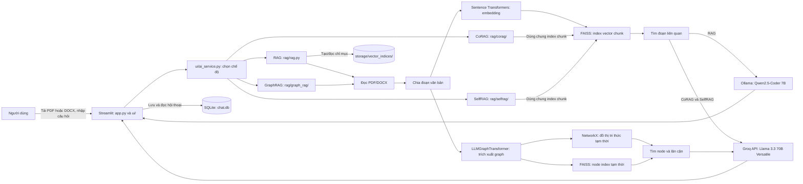
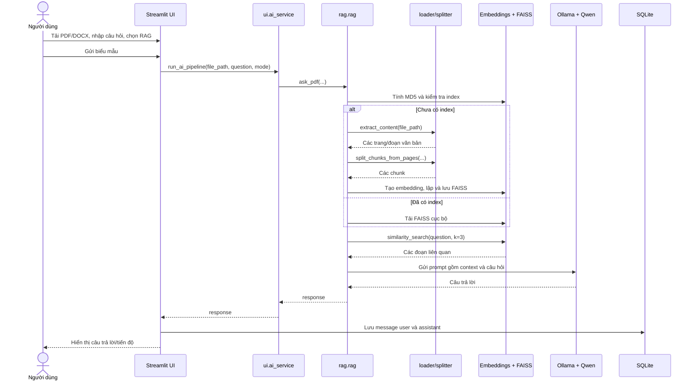
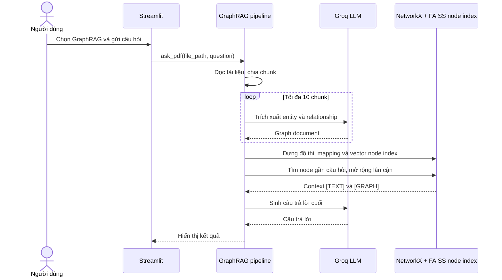
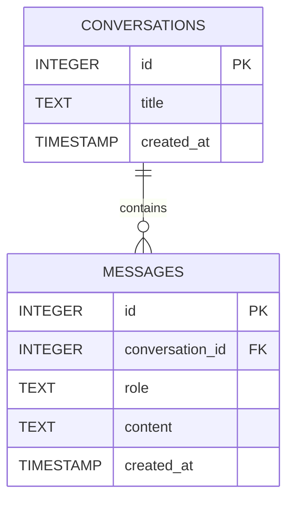

# Hướng dẫn hoạt động đồ án SmartDoc AI

> Tài liệu này mô tả những gì có thể xác minh từ mã nguồn và các tệp dự án hiện có. Những chi tiết chưa được chốt hoặc chưa có bằng chứng được đánh dấu **Cần xác nhận**. Tên đề tài trong `CCNLTHD.md` là căn cứ tham khảo; tên đề tài đã được duyệt chính thức vẫn **Cần xác nhận**.

## Mục lục

1. [Tổng quan đồ án](#1-tổng-quan-đồ-án)
2. [Kiến trúc tổng thể](#2-kiến-trúc-tổng-thể)
3. [Cách hoạt động của hệ thống](#3-cách-hoạt-động-của-hệ-thống)
4. [Phân tích công nghệ sử dụng](#4-phân-tích-công-nghệ-sử-dụng)
5. [Cơ sở dữ liệu và mô hình dữ liệu](#5-cơ-sở-dữ-liệu-và-mô-hình-dữ-liệu)
6. [API và giao tiếp giữa các thành phần](#6-api-và-giao-tiếp-giữa-các-thành-phần)
7. [Hướng dẫn cài đặt và chạy](#7-hướng-dẫn-cài-đặt-và-chạy)
8. [Điểm nổi bật và hạn chế](#8-điểm-nổi-bật-và-hạn-chế)
9. [Câu hỏi bảo vệ có thể gặp](#9-câu-hỏi-bảo-vệ-có-thể-gặp)

## 1. Tổng quan đồ án

### 1.1. Tên và mục tiêu

- **Tên sản phẩm:** SmartDoc AI (xem `README.md`, `app.py`).
- **Tên đề tài được nêu trong tài liệu hiện có:** “Xây dựng hệ thống hỏi đáp tài liệu PDF sử dụng kiến trúc RAG với thư viện LangChain và cơ sở dữ liệu vector FAISS” (xem `CCNLTHD.md`, `Bao_cao_tong_hop_RAG_SmartDoc_AI.md`). Tên chính thức đã được duyệt **Cần xác nhận**.
- **Mục tiêu:** tạo ứng dụng có giao diện để người dùng tải tài liệu PDF/DOCX, đặt câu hỏi về nội dung và nhận câu trả lời do mô hình ngôn ngữ tạo ra sau bước tìm đoạn văn bản liên quan (xem `ui/main_content.py`, `rag/rag.py`).

**RAG** (Retrieval-Augmented Generation, sinh câu trả lời có tăng cường bằng truy xuất) nghĩa là hệ thống tìm các đoạn tài liệu liên quan trước, rồi đưa chúng cùng câu hỏi cho mô hình tạo câu trả lời. Cách này giúp cung cấp tài liệu làm ngữ cảnh; không bảo đảm mọi câu trả lời luôn chính xác.

### 1.2. Bài toán và đối tượng sử dụng

Ứng dụng hướng đến việc tra cứu nội dung tài liệu bằng câu hỏi ngôn ngữ tự nhiên thay vì phải tìm thủ công từng trang. Người sử dụng dự kiến là người cần tra cứu tài liệu học tập hoặc công việc; đây là đối tượng suy ra từ chức năng tải tài liệu, không phải phân quyền người dùng đã được triển khai (xem `ui/main_content.py`).

### 1.3. Chức năng chính

- Tải lên tệp PDF hoặc DOCX; giao diện giới hạn kích thước tệp 10 MB (xem `ui/main_content.py`).
- Chọn một trong bốn chế độ: RAG, GraphRAG, CoRAG, SelfRAG (xem `ui/main_content.py`, `ui/ai_service.py`).
- Chia nội dung thành các đoạn, tạo embedding, tìm đoạn tương tự và sinh câu trả lời (xem `rag/loader.py`, `rag/splitter.py`, `rag/embeddings.py`, `rag/rag.py`).
- Điều chỉnh chunk size, chunk overlap và một số tham số sinh văn bản ở sidebar (xem `ui/sidebar.py`).
- Lưu câu hỏi/câu trả lời theo cuộc trò chuyện trong SQLite; chọn cuộc trò chuyện cũ, xem câu hỏi đã hỏi và xóa cuộc trò chuyện (xem `db/db.py`, `ui/sidebar.py`, `ui/main_content.py`).
- Hiển thị tiến độ xử lý và thông báo lỗi cơ bản (xem `ui/main_content.py`, các pipeline trong `rag/`).

## 2. Kiến trúc tổng thể

### 2.1. Kiểu kiến trúc

Đây là ứng dụng Python đơn khối với giao diện Streamlit; các thành phần giao diện, xử lý tài liệu, truy xuất, gọi mô hình và lưu lịch sử nằm trong cùng một dự án, không phải kiến trúc microservices. Các chức năng gọi nhau trực tiếp bằng hàm Python; code hiện có không định nghĩa máy chủ REST riêng (xem `app.py`, `ui/ai_service.py`, `rag/`, `db/`).

### 2.2. Sơ đồ kiến trúc và dữ liệu



Sơ đồ thể hiện quan hệ ở mức module. Riêng GraphRAG trích xuất đồ thị từ tối đa 10 chunk rồi tìm trên đồ thị và một FAISS node index được dựng trong lần gọi; code không lưu index đồ thị đó vào `storage/vector_indices/`. CoRAG và SelfRAG dùng chung bộ tạo/tải document index với RAG cơ bản (xem `rag/graph_rag/graphrag.py`, `rag/graph_rag/extractgraph.py`, `rag/graph_rag/vectorstore.py`, `rag/corag/corag.py`, `rag/selfrag/selfrag.py`).

### 2.3. Cấu trúc thư mục

```text
SmartDoc_AI-main/
├── app.py                         # Điểm vào ứng dụng Streamlit
├── README.md                      # Giới thiệu và hướng dẫn chạy
├── requirements.txt               # Các package Python và phiên bản được ghim
├── .gitignore                     # Bỏ qua .env, chat.db, tệp tạm và cache Python
├── Bao_cao_mo_dau_Chuong_1.md     # Bản nháp báo cáo; có nội dung cần đối chiếu
├── Bao_cao_tong_hop_RAG_SmartDoc_AI.md # Báo cáo về RAG và đồ án
├── CCNLTHD.md                     # Tài liệu đề cương/định hướng đồ án
├── ui/
│   ├── main_content.py            # Tải tệp, nhập câu hỏi, điều phối và hiển thị
│   ├── sidebar.py                 # Chọn chế độ/cấu hình và quản lý lịch sử
│   ├── ai_service.py              # Chọn pipeline RAG theo chế độ
│   └── theme.py                   # CSS cho giao diện Streamlit
├── rag/
│   ├── loader.py                  # Trích xuất văn bản từ PDF và DOCX
│   ├── splitter.py                # Chia văn bản thành các chunk
│   ├── embeddings.py              # Khởi tạo embedding model
│   ├── prompt.py                  # Prompt cho các luồng trả lời
│   ├── groq_model.py              # Khởi tạo ChatGroq và đọc GROQ_API_KEY
│   ├── rag.py                     # RAG cơ bản và lưu/tải FAISS
│   ├── graph_rag/                 # Trích xuất, dựng và truy vấn đồ thị
│   ├── corag/                     # Phân rã câu hỏi, truy xuất và tổng hợp câu trả lời
│   └── selfrag/                   # Vòng lặp retrieval và đánh giá đủ ngữ cảnh
├── db/
│   ├── db.py                      # Kết nối SQLite và thao tác lịch sử
│   └── session.py                 # Khởi tạo một số khóa Streamlit session_state
├── storage/vector_indices/        # Các FAISS index đã lưu theo mã băm tài liệu
├── vector_store/                  # Có index FAISS; vai trò trong code hiện tại Cần xác nhận
├── data/                          # Tệp dữ liệu mẫu và tài liệu thử
└── test/
    ├── unittest/                  # Test loader, prompt, splitter
    └── integrationtest/           # Test pipeline RAG
```

Trong project còn có `chat.db` và một số PDF tạm ở thư mục gốc; `.gitignore` loại `chat.db` và `temp_*.pdf` khỏi Git. Các file `index.faiss`/`index.pkl` là dữ liệu nhị phân chỉ mục, không phải source code. `vector_store/` tồn tại nhưng code RAG đang chỉ rõ đường dẫn `storage/vector_indices`; mục đích của index ở `vector_store/` **Cần xác nhận** (xem `.gitignore`, `rag/rag.py`).

## 3. Cách hoạt động của hệ thống

### 3.1. Luồng hỏi đáp RAG cơ bản

1. Người dùng tải PDF hoặc DOCX và nhập câu hỏi trong `ui/main_content.py`. Giao diện kiểm tra loại tệp được hiển thị và giới hạn 10 MB; tệp được ghi tạm thành `temp_<tên tệp>`.
2. Khi gửi biểu mẫu, `run_ai_pipeline()` trong `ui/ai_service.py` chuyển `file_path`, `question`, `mode` tới `rag.rag.ask_pdf()`.
3. `get_or_create_vector_db()` trong `rag/rag.py` tính MD5 của toàn bộ tệp. Nếu thư mục index tương ứng đã có, hàm tải FAISS từ đĩa; nếu chưa, nó gọi `extract_content()` ở `rag/loader.py`, chia văn bản bằng `split_chunks_from_pages()` ở `rag/splitter.py`, mã hóa bằng embedding model và ghi index vào `storage/vector_indices/`.
4. Hệ thống truy xuất tối đa ba đoạn bằng `similarity_search(question, k=3)`, ghép nguồn và nội dung các đoạn vào context rồi tạo prompt bằng `build_prompt()` ở `rag/prompt.py`.
5. `OllamaLLM` gọi model `qwen2.5-coder:7b` với `temperature`, `top_p`, `repeat_penalty` hiện có trong Streamlit session state.
6. Kết quả được lưu dưới dạng message `user` và `assistant` trong SQLite; tiêu đề cuộc trò chuyện đầu tiên được tạo từ tối đa 50 ký tự đầu của câu hỏi. Giao diện hiển thị kết quả (xem `ui/main_content.py`, `db/db.py`).

Ví dụ rút gọn về thao tác retrieval và generation (xem `rag/rag.py`):

```python
docs = db.similarity_search(question, k=3)
context = "\n\n".join([
    f"Source: {doc.metadata.get('source')}\nContent: {doc.page_content}"
    for doc in docs
])
prompt = build_prompt(context, question)
llm = OllamaLLM(
    model="qwen2.5-coder:7b",
    temperature=st.session_state.temperature,
    top_p=st.session_state.top_p,
    repeat_penalty=st.session_state.repeat_penalty
)
response = llm.invoke(prompt)
```

Luồng tuần tự chính:



### 3.2. Luồng GraphRAG

`rag.graph_rag.graphrag.ask_pdf()` đọc và chia tài liệu, nhưng chỉ đưa tối đa 10 chunk vào `extract_graph_documents()` (xem `rag/graph_rag/extractgraph.py`). `LLMGraphTransformer` dùng Groq để trích node/relationship theo các loại đã cho; `mapping.py` nối node với đoạn nguồn, `networkx.py` dựng đồ thị vô hướng, `vectorstore.py` tạo FAISS trên tên node, rồi `search.py` tìm node và các cạnh lân cận. Cuối cùng, prompt GraphRAG được gửi đến Groq để trả lời (xem `rag/graph_rag/graphrag.py`, `rag/graph_rag/search.py`).



### 3.3. Luồng CoRAG

Trong `rag/corag/corag.py`, câu hỏi được phân rã qua Groq, các câu hỏi con được truy xuất riêng từ FAISS, mỗi câu được trả lời bằng Groq rồi `combine_prompt()` tổng hợp câu trả lời cuối. Prompt yêu cầu tối đa ba câu hỏi con, nhưng hàm `decompose()` thực tế cắt kết quả tối đa năm câu. `max_hops` được khai báo trong hàm chính nhưng không được dùng trong luồng này (xem `rag/corag/decompose.py`, `rag/corag/search.py`, `rag/corag/subanswer.py`, `rag/corag/corag.py`).

### 3.4. Luồng SelfRAG theo hiện trạng mã nguồn

Tên chế độ trên giao diện là SelfRAG, nhưng implementation hiện tại trong `rag/selfrag/selfrag.py` gọi `run_corag_loop()` từ `rag/selfrag/searchloop.py`. Vòng lặp tìm đoạn, kiểm tra độ đủ của ngữ cảnh bằng prompt JSON và có thể sửa truy vấn; kết quả sau đó được dùng để tạo prompt câu trả lời. Vì vậy, khi thuyết trình nên mô tả đúng đây là vòng lặp retrieval/đánh giá đủ ngữ cảnh đang được code triển khai, thay vì khẳng định đã triển khai đầy đủ một thuật toán Self-RAG chuẩn. Module đặt trong `selfrag/`, nhưng code này không gọi CoRAG pipeline trong `rag/corag/`.

### 3.5. Luồng lịch sử hội thoại

`db/db.py` tạo hai bảng SQLite. Sidebar lấy các cuộc trò chuyện có message, mở cuộc trò chuyện hoặc xóa nó. Khi chọn câu hỏi trong lịch sử, `ui/main_content.py` tải câu trả lời đã lưu, cố gắng giải mã JSON rồi hiển thị. Tạo chat mới tạo bản ghi conversation; chat rỗng không xuất hiện trong danh sách vì truy vấn lịch sử dùng `JOIN` với bảng messages (xem `db/db.py`, `ui/sidebar.py`, `ui/main_content.py`).

## 4. Phân tích công nghệ sử dụng

**Embedding** là phép đổi văn bản thành một dãy số để máy có thể so sánh mức độ gần nhau về ý nghĩa. **Vector store** là nơi lưu các dãy số này cùng văn bản để tìm lại đoạn phù hợp. Các phiên bản package dưới đây được đọc từ `requirements.txt`; version của runtime Ollama, các model tải ngoài và môi trường Python không được pin đầy đủ trong repo.

### 4.1. Frontend

| Công nghệ và phiên bản | Là gì và vai trò trong đồ án | Cấu hình/cách dùng | Ưu điểm và hạn chế |
|---|---|---|---|
| Streamlit `1.56.0` | Framework tạo giao diện web bằng Python. | `app.py` gọi `st.set_page_config()`, `render_sidebar()` và `render_main()`. Upload, radio, form, slider, progress và session state nằm trong `ui/main_content.py`, `ui/sidebar.py`. | Dễ dựng demo trong cùng dự án; giao diện phụ thuộc vào một tiến trình Python Streamlit, chưa tách frontend/backend. |
| CSS (không có package riêng) | Quy tắc định dạng trang. | `ui/theme.py` chèn CSS bằng `st.markdown(..., unsafe_allow_html=True)`. | Tùy biến nhanh; dùng selector nội bộ của Streamlit nên có thể cần chỉnh khi UI framework thay đổi. |

### 4.2. Backend, xử lý tài liệu và thư viện kết nối LLM

| Công nghệ và phiên bản | Là gì và vai trò trong đồ án | Cấu hình/cách dùng | Ưu điểm và hạn chế |
|---|---|---|---|
| Python (README ghi `3.8+`; version thực tế **Cần xác nhận**) | Ngôn ngữ triển khai ứng dụng. | `app.py`, `ui/`, `rag/`, `db/` đều là module Python. Repo không có `.python-version`, `pyproject.toml` hoặc cấu hình pin phiên bản Python. | Một ngôn ngữ cho UI và pipeline; cần xác nhận tương thích Python với các package đã ghim trước khi cài. |
| LangChain `1.2.15` và các package LangChain liên quan | Bộ công cụ kết nối tài liệu, splitter, vector store, embedding và mô hình. | Các import đang dùng trực tiếp gồm `langchain-core 1.2.28`, `langchain-community 0.4.1`, `langchain-text-splitters 1.1.1`, `langchain-ollama 1.1.0`, `langchain-huggingface 1.2.1`, `langchain-groq 1.1.2`, `langchain-experimental 0.4.1`. Xem `rag/`. | Chuẩn hóa việc gọi các adapter và thành phần RAG; nhiều gói/version làm dependency set lớn, cần quản lý tương thích. |
| `pdfplumber` `0.11.9` | Thư viện đọc văn bản PDF. | `extract_pages_from_pdf()` duyệt trang, gọi `extract_text()` và gắn nhãn `Page n` (xem `rag/loader.py`). | Có thể đọc text theo trang; code hiện tại không OCR trang scan và có thể không trích xuất đúng mọi layout. |
| `python-docx` `1.2.0` | Thư viện đọc tài liệu DOCX. | `extract_paragraphs_from_docx()` lấy các paragraph không rỗng (xem `rag/loader.py`). | Hỗ trợ DOCX ngoài PDF; code chỉ duyệt paragraph, không thể hiện xử lý đầy đủ bảng/ảnh. |
| `python-dotenv` `1.2.2` | Nạp biến môi trường từ file `.env`. | `get_groq_model()` gọi `load_dotenv()` rồi đọc `GROQ_API_KEY` (xem `rag/groq_model.py`). | Không cần ghi khóa API vào code; repo không có `.env.example`, nên tên biến là căn cứ cấu hình rõ nhất. |
| `langdetect` `1.0.9` | Nhận diện ngôn ngữ văn bản. | `build_prompt()` và các prompt khác dùng `detect(question)` để chọn nội dung Việt/Anh; khi nhận diện lỗi thì dùng tiếng Việt (xem `rag/prompt.py`). | Có prompt hai ngôn ngữ; nhận diện câu ngắn có thể không chính xác. |

Các package LangChain nêu trên có version cụ thể trong `requirements.txt`; package `langchain` là framework cấp cao, trong khi code hiện import chủ yếu từ các module `langchain_*` chuyên biệt. Package còn lại trong file requirements phần lớn là dependency bắc cầu được pin cùng môi trường, không phải mỗi package đều được gọi trực tiếp từ source.

### 4.3. Cơ sở dữ liệu và tìm kiếm vector

| Công nghệ và phiên bản | Là gì và vai trò trong đồ án | Cấu hình/cách dùng | Ưu điểm và hạn chế |
|---|---|---|---|
| SQLite (module `sqlite3` của Python; không có version package riêng) | Cơ sở dữ liệu quan hệ gọn, lưu thành file. | Kết nối `sqlite3.connect("chat.db", check_same_thread=False)` và tạo `conversations`, `messages` (xem `db/db.py`). | Không cần server DB riêng; phù hợp demo cục bộ, chưa có quản lý migration, đa người dùng hoặc chính sách lưu trữ nâng cao. |
| FAISS CPU `1.13.2` (`faiss-cpu`) | Thư viện lập chỉ mục và tìm kiếm vector gần nhau; không phải bảng trong SQLite. | LangChain `FAISS.from_documents()`, `similarity_search(k=3)`, `save_local()` và `load_local()` (xem `rag/rag.py`). | Lưu/tìm vector cục bộ; file index là binary, không tự cung cấp quản lý người dùng hay API DB. |
| NetworkX `3.6.1` | Thư viện cấu trúc và thao tác đồ thị. | Dựng `nx.Graph()` và thêm node/cạnh từ GraphDocument (xem `rag/graph_rag/networkx.py`). | Hỗ trợ duyệt quan hệ cho GraphRAG; đồ thị hiện được dựng trong bộ nhớ mỗi lượt, không phải graph database bền vững. |

### 4.4. AI/ML và mô hình

| Công nghệ/mô hình và version | Là gì và vai trò trong đồ án | Cách dùng | Ưu điểm và hạn chế |
|---|---|---|---|
| `sentence-transformers/paraphrase-multilingual-mpnet-base-v2` (model; revision **Cần xác nhận**) | Model embedding đa ngôn ngữ để biểu diễn chunk và câu hỏi thành vector. | `HuggingFaceEmbeddings(model_name=...)` được cache bằng `st.cache_resource` (xem `rag/embeddings.py`). Package `sentence-transformers 5.4.0`, `transformers 5.5.3`, `torch 2.11.0` nằm trong `requirements.txt`. | Có tên model rõ ràng và hỗ trợ nhiều ngôn ngữ; revision không được ghim trong code, việc tải model có thể cần mạng và tài nguyên cục bộ. |
| Ollama + `qwen2.5-coder:7b` (version runtime/model **Cần xác nhận**) | Ollama là runtime chạy LLM; Qwen là model sinh văn bản, hai khái niệm không đồng nhất. | `OllamaLLM(model="qwen2.5-coder:7b", ...)` được gọi trong luồng RAG cơ bản (xem `rag/rag.py`). README hướng dẫn cài Ollama và `ollama pull qwen2.5-coder:7b` (xem `README.md`). | Chạy model qua runtime cục bộ; cần tải model và có tài nguyên máy phù hợp. Chưa có số đo RAM/VRAM, tốc độ hoặc chất lượng được kiểm chứng trong code. |
| Groq API + `llama-3.3-70b-versatile` (model/API version **Cần xác nhận**) | Dịch vụ suy luận từ xa dùng cho một số mode. | `ChatGroq` được khởi tạo trong `rag/groq_model.py`, đọc `GROQ_API_KEY`, `temperature=0`; được gọi trong GraphRAG, CoRAG và luồng đang gắn nhãn SelfRAG. | Không cần chạy model Groq trên máy cá nhân; phụ thuộc mạng, API key, dịch vụ bên ngoài và điều khoản của nhà cung cấp. |
| `LLMGraphTransformer` (package `langchain-experimental 0.4.1`) | Thành phần biến nội dung thành node và quan hệ dạng graph bằng LLM. | Giới hạn loại node/relationship trong `get_graph_transformer()`; xử lý tối đa 10 chunk trong một lần gọi GraphRAG (xem `rag/graph_rag/graphrag.py`, `extractgraph.py`). | Cho phép thử biểu diễn quan hệ; độ chính xác phụ thuộc LLM và hiện mới xét số chunk giới hạn. |
| Prompting (logic nội bộ; không có version package riêng) | Hướng dẫn mô hình cách dùng context và định dạng câu trả lời. | Các hàm trong `rag/prompt.py` xây prompt Việt/Anh, GraphRAG, phân rã câu hỏi và kiểm tra độ đủ context. | Dễ điều chỉnh; prompt không thay thế kiểm định đáp án và không ngăn chắc chắn việc mô hình suy diễn. |

### 4.5. Xác thực, bảo mật, triển khai và công cụ khác

- **Xác thực dịch vụ:** chỉ thấy đọc `GROQ_API_KEY` qua `.env`/environment trong `rag/groq_model.py`; không thấy đăng nhập, phân quyền người dùng, hay xác thực người dùng ứng dụng (xem `ui/`, `db/`).
- **Dữ liệu:** lịch sử lưu trong `chat.db`, tệp tải lên được ghi tạm với tên bắt đầu `temp_`, vector index lưu dưới `storage/vector_indices/`. Không thấy mã hóa dữ liệu ở tầng ứng dụng trong các module đã đọc.
- **Triển khai/DevOps:** README có lệnh chạy Streamlit, nhưng repo không có Dockerfile, docker-compose, CI workflow hay manifest triển khai. Docker được nhắc trong tài liệu định hướng, không có bằng chứng đã cấu hình trong source (xem `README.md`, `CCNLTHD.md`).
- **Công cụ test:** `pytest` được import trong tests, nhưng không có trong `requirements.txt`; version và lệnh chạy thành công hiện **Cần xác nhận** (xem `test/`, `requirements.txt`).
- **Các thư viện:** `numpy`, `torch`, `transformers` và nhiều package khác được liệt kê trong `requirements.txt`; phần lớn không được import trực tiếp ở module nghiệp vụ mà là dependency của các package AI/vector.

## 5. Cơ sở dữ liệu và mô hình dữ liệu

### 5.1. Bảng SQLite

| Bảng | Trường | Kiểu khai báo | Ý nghĩa |
|---|---|---|---|
| `conversations` | `id` | `INTEGER PRIMARY KEY AUTOINCREMENT` | Mã cuộc trò chuyện. |
| `conversations` | `title` | `TEXT` | Tiêu đề, mặc định lúc tạo là `"New Chat"`; sau câu hỏi đầu có thể được thay bằng tối đa 50 ký tự đầu. |
| `conversations` | `created_at` | `TIMESTAMP DEFAULT CURRENT_TIMESTAMP` | Thời điểm tạo. |
| `messages` | `id` | `INTEGER PRIMARY KEY AUTOINCREMENT` | Mã message. |
| `messages` | `conversation_id` | `INTEGER` | Mã cuộc trò chuyện được khai báo tham chiếu `conversations(id)`. |
| `messages` | `role` | `TEXT` | Vai trò message; code ghi `"user"` hoặc `"assistant"`. |
| `messages` | `content` | `TEXT` | Nội dung câu hỏi hoặc câu trả lời. |
| `messages` | `created_at` | `TIMESTAMP DEFAULT CURRENT_TIMESTAMP` | Thời điểm tạo message. |

Quan hệ dự kiến là một conversation có nhiều message; khai báo khóa ngoại nằm trong `db/db.py`. Code không phát lệnh `PRAGMA foreign_keys=ON`, do đó việc SQLite thực thi ràng buộc khóa ngoại khi ghi **Cần xác nhận**.



FAISS index không phải bảng SQL: index lưu file `index.faiss` và metadata ở `index.pkl` trong thư mục con được đặt theo MD5 của tài liệu (xem `rag/rag.py`). Đường dẫn SQLite là tương đối (`chat.db`), vì vậy file sử dụng thực tế phụ thuộc thư mục làm việc khi chạy ứng dụng.

## 6. API và giao tiếp giữa các thành phần

Code không khai báo endpoint HTTP/REST riêng. Người dùng tương tác qua giao diện Streamlit; các pipeline được gọi trực tiếp bằng hàm Python. Ollama/Groq là các dịch vụ model mà adapter tương ứng kết nối tới, không phải API do đồ án tự xây dựng.

| Kiểu giao tiếp | Hàm/điểm gọi | Tham số chính | Kết quả |
|---|---|---|---|
| Chọn pipeline nội bộ | `ui.ai_service.run_ai_pipeline()` | `file_path`, `question`, `mode`, `progress` | Kết quả của RAG, GraphRAG, CoRAG hoặc SelfRAG. |
| RAG | `rag.rag.ask_pdf()` | Đường dẫn file, câu hỏi, callback tiến độ | Chuỗi câu trả lời do Ollama sinh. |
| GraphRAG | `rag.graph_rag.graphrag.ask_pdf()` | Đường dẫn file, câu hỏi, callback tiến độ | Chuỗi câu trả lời từ context graph/text. |
| CoRAG | `rag.corag.corag.ask_pdf_corag()` | Đường dẫn file, câu hỏi, callback tiến độ | Câu trả lời tổng hợp bằng Groq. |
| SelfRAG (implementation hiện tại) | `rag.selfrag.selfrag.ask_pdf_selfrag()` | Đường dẫn file, câu hỏi, callback tiến độ | Câu trả lời sau vòng retrieval/đủ context, bằng Groq. |
| Lưu lịch sử | Các hàm trong `db/db.py` | conversation id, role, content | Ghi/đọc/xóa SQLite; không trả JSON API cho client HTTP. |

Không có bảng endpoint HTTP vì repo hiện không định nghĩa route hoặc REST server.

## 7. Hướng dẫn cài đặt và chạy

### 7.1. Yêu cầu môi trường

- Python và `pip`; README ghi Python `3.8+`, nhưng phiên bản Python phù hợp chính xác với toàn bộ phiên bản dependency hiện pin **Cần xác nhận** (xem `README.md`, `requirements.txt`).
- Ollama đã cài và đang chạy nếu dùng mode RAG; tải model `qwen2.5-coder:7b` theo README.
- Biến môi trường `GROQ_API_KEY` nếu dùng GraphRAG, CoRAG hoặc mode SelfRAG đang có trong code (xem `rag/groq_model.py`, `README.md`).
- Dung lượng và tài nguyên đủ cho các package/model; mức phần cứng tối thiểu không được chỉ định trong repo, **Cần xác nhận**.

### 7.2. Cài đặt trên Windows PowerShell

Chạy các lệnh từ thư mục `SmartDoc_AI-main`:

```powershell
py -m venv .venv
.\.venv\Scripts\Activate.ps1
python -m pip install --upgrade pip
pip install -r requirements.txt
```

Thiết lập Ollama theo hướng dẫn cài đặt của Ollama, khởi động dịch vụ nếu chưa chạy, rồi tải model:

```powershell
ollama pull qwen2.5-coder:7b
```

Nếu dùng các mode gọi Groq, đặt `GROQ_API_KEY` trong môi trường hoặc file `.env` tại thư mục chạy ứng dụng; **không đưa giá trị khóa vào báo cáo hoặc Git**. `.env` được bỏ qua bởi `.gitignore`.

### 7.3. Khởi động ứng dụng

```powershell
streamlit run app.py
```

Ứng dụng chạy từ thư mục dự án để các đường dẫn tương đối `chat.db`, `storage/vector_indices` và `temp_<tên file>` trỏ tới đúng vị trí mong đợi (xem `app.py`, `db/db.py`, `rag/rag.py`, `ui/main_content.py`).

### 7.4. Kiểm thử

Các test hiện có ở `test/unittest/` và `test/integrationtest/`; có thể thử chạy:

```powershell
python -m pytest test
```

Lưu ý: `pytest` không được khai báo trong `requirements.txt`. Ngoài ra, một số assertion trong test cũ không khớp cấu trúc đang trả về của source: loader/splitter hiện dùng khóa `source`, trong khi test đòi khóa `page`; test integration cũng giả định một số lời gọi FAISS khác code hiện tại (xem `rag/loader.py`, `rag/splitter.py`, `test/unittest/test_loader.py`, `test/unittest/test_splitter.py`, `test/integrationtest/test_rag.py`). Vì vậy, không nên tuyên bố toàn bộ test pass nếu chưa chạy và cập nhật test tương ứng.

## 8. Điểm nổi bật và hạn chế

### 8.1. Điểm nổi bật có trong code

- Pipeline RAG có đủ bước trích xuất, chunking, embedding, vector retrieval và generation (xem `rag/loader.py`, `rag/splitter.py`, `rag/embeddings.py`, `rag/rag.py`).
- Index của RAG cơ bản được lưu theo nội dung file để tái sử dụng, không phải tạo lại với cùng tài liệu (xem `rag/rag.py`).
- Có một số hướng tiếp cận retrieval khác nhau qua bốn lựa chọn giao diện; GraphRAG dùng NetworkX, CoRAG phân rã câu hỏi và module mang tên SelfRAG lặp truy xuất (xem `ui/ai_service.py`, `rag/graph_rag/`, `rag/corag/`, `rag/selfrag/`).
- Có lưu lịch sử câu hỏi/câu trả lời bằng SQLite và cấu hình chunking/tham số LLM trên giao diện (xem `db/db.py`, `ui/sidebar.py`).

### 8.2. Hạn chế và điểm cần nói rõ khi bảo vệ

- Chỉ số MD5 của file là khóa cache index; `chunk_size` và `chunk_overlap` không nằm trong khóa. Nếu index đã tồn tại, thay đổi slider không tự tạo index mới cho cùng file (xem `rag/rag.py`, `ui/sidebar.py`).
- RAG cơ bản truy xuất top-3 chunk; code không hiển thị nguồn/đánh số trích dẫn trong câu trả lời cuối (xem `rag/rag.py`, `ui/main_content.py`).
- GraphRAG giới hạn trích xuất ở 10 chunk và dựng graph/node index trong bộ nhớ theo mỗi lần gọi (xem `rag/graph_rag/extractgraph.py`, `rag/graph_rag/graphrag.py`).
- Tên SelfRAG có thể khiến người nghe kỳ vọng thuật toán khác với implementation hiện tại; nên trình bày đúng vòng retrieval và kiểm tra đủ ngữ cảnh đang được gọi (xem `rag/selfrag/selfrag.py`, `rag/selfrag/searchloop.py`).
- Các mode dùng Groq phụ thuộc dịch vụ bên ngoài và `GROQ_API_KEY`; RAG cơ bản dùng Ollama local theo cấu hình (xem `rag/groq_model.py`, `rag/rag.py`).
- Giao diện nhận cả PDF/DOCX nhưng phần hướng dẫn sidebar chỉ ghi PDF; trích xuất PDF dùng `pdfplumber.extract_text()` và không có OCR cho PDF scan (xem `ui/main_content.py`, `ui/sidebar.py`, `rag/loader.py`).
- Tệp tạm tạo theo tên do người dùng tải lên và trong code không thấy bước xóa sau xử lý; chính sách dọn dẹp/giới hạn lưu trữ **Cần xác nhận** (xem `ui/main_content.py`).
- Không thấy kiểm thử tự động được xác nhận pass; test hiện tại có dấu hiệu không đồng bộ với source. Không có Docker/CI/deployment manifest, đăng nhập, hay số đo benchmark trong các tệp dự án đã đọc.

### 8.3. Hướng phát triển có thể đề xuất

Các hướng sau là đề xuất, chưa phải chức năng đang có: đưa chunk config vào khóa index hoặc cung cấp nút rebuild; bổ sung hiển thị nguồn được truy xuất; dọn tệp tạm; đồng bộ lại test với schema `source`; ghim phiên bản Python/model; bổ sung kiểm thử tích hợp có mock ổn định; và ghi nhận benchmark trên một tập câu hỏi/tài liệu cố định.

## 9. Câu hỏi bảo vệ có thể gặp

1. **RAG là gì và vì sao chọn cho bài toán này?**  
   RAG tìm đoạn liên quan trong tài liệu trước, rồi đưa đoạn đó cùng câu hỏi vào prompt cho LLM. Code thực hiện qua FAISS `similarity_search()` rồi gọi model sinh câu trả lời (xem `rag/rag.py`).

2. **Dữ liệu đi từ PDF đến câu trả lời qua những bước nào?**  
   `extract_content()` đọc trang, `split_chunks_from_pages()` chia đoạn, `HuggingFaceEmbeddings` tạo vector, FAISS tìm top-3, `build_prompt()` ghép context và `OllamaLLM` sinh câu trả lời (xem `rag/loader.py`, `rag/splitter.py`, `rag/embeddings.py`, `rag/rag.py`).

3. **FAISS lưu dữ liệu ở đâu? Có lưu trong SQLite không?**  
   Không. FAISS lưu file index cục bộ trong `storage/vector_indices/<MD5>/`; SQLite `chat.db` lưu cuộc trò chuyện và message (xem `rag/rag.py`, `db/db.py`).

4. **Ứng dụng có API REST để frontend gọi không?**  
   Không thấy route REST trong repo. Giao diện Streamlit gọi trực tiếp các hàm Python thông qua `run_ai_pipeline()` (xem `ui/main_content.py`, `ui/ai_service.py`).

5. **Khác nhau giữa Ollama và Qwen là gì?**  
   Ollama là runtime phục vụ chạy model; `qwen2.5-coder:7b` là tên model mà `OllamaLLM` cấu hình trong code (xem `rag/rag.py`, `README.md`).

6. **GraphRAG tạo và sử dụng đồ thị thế nào?**  
   `LLMGraphTransformer` trích node/relationship, `NetworkX` dựng đồ thị, FAISS tìm node tương tự câu hỏi, rồi `search_graph()` thu thập context dạng text và quan hệ để Groq trả lời (xem `rag/graph_rag/graphrag.py`, `networkx.py`, `search.py`).

7. **SelfRAG hiện tại tự kiểm tra câu trả lời ra sao?**  
   Code kiểm tra mức đủ của context qua prompt yêu cầu JSON và có thể sửa truy vấn trong vòng retrieval. Đây là implementation hiện tại; không nên khẳng định thêm các bước mà code chưa thể hiện (xem `rag/selfrag/searchloop.py`, `rag/selfrag/sufficiency.py`).

8. **Nếu đổi chunk size, index có được tạo lại không?**  
   Không tự động nếu index cùng MD5 tài liệu đã tồn tại, vì đường dẫn cache được tính từ nội dung file chứ không kèm chunk size/overlap. Đây là hạn chế cần nêu (xem `rag/rag.py`, `ui/sidebar.py`).

9. **Lịch sử hội thoại được lưu thế nào?**  
   SQLite lưu trong hai bảng `conversations` và `messages`; câu hỏi/câu trả lời gắn với `conversation_id` (xem `db/db.py`).

10. **Hệ thống có đảm bảo câu trả lời luôn đúng tài liệu không?**  
    Không. RAG cung cấp context truy xuất cho model, nhưng chất lượng còn phụ thuộc trích xuất, chunking, embedding, retrieval và model; code không có bước xác minh độc lập câu trả lời. Có thể cải thiện bằng test truy xuất, đánh giá câu trả lời và hiển thị nguồn.
